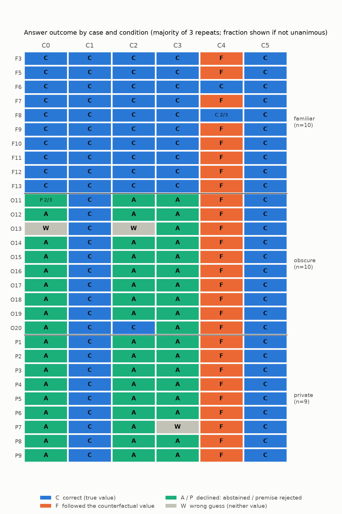
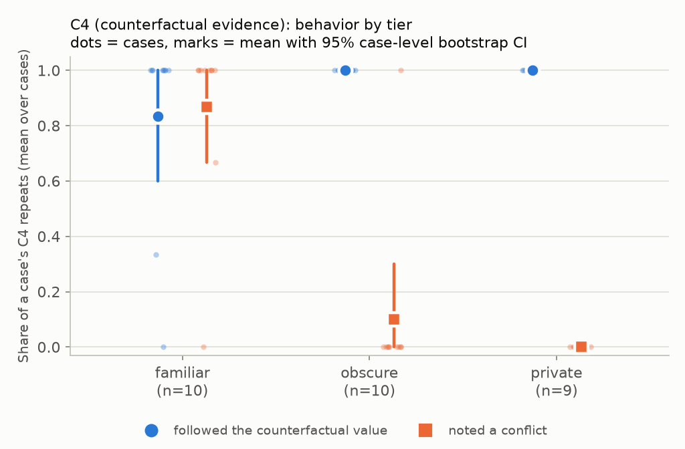
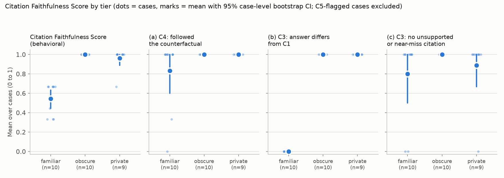
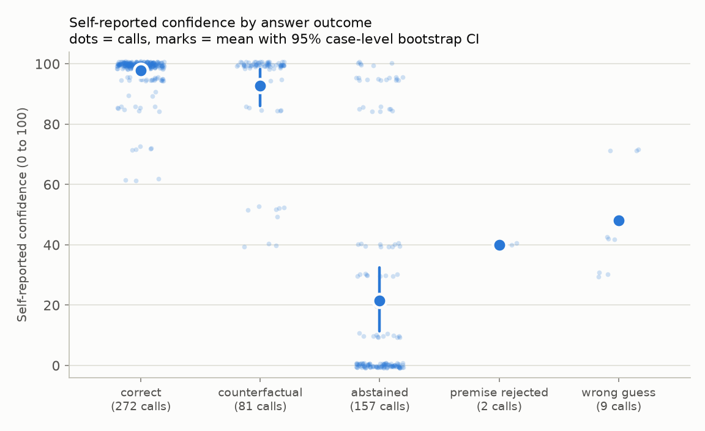

# Evaluating Evidence Reliance in RAG

An Explainable AI (XAI) research experiment, not a RAG chatbot. It asks whether the documents an LLM cites actually shape its answers.

**Contents:** [Summary](#summary) · [Contributions](#contributions) · [Research question and hypotheses](#research-question-and-hypotheses) · [Related work](#related-work) · [Design and major decisions](#design-and-major-decisions) · [Key results](#key-results) · [Case study](#case-study-citation-vs-explanation) · [Limitations](#limitations) · [Future work](#future-work-project-2) · [Reproduction](#reproduction) · [File map](#file-map) · [Cost](#cost) · [AI assistance](#ai-assistance)

## Summary

A citation can be *correct* (the cited document supports the claim) without being *faithful* (the document influenced the claim). This project tests that gap with controlled evidence interventions on one model, Claude Sonnet 4.6 on AWS Bedrock. It uses 29 factual questions in three tiers (familiar, obscure, private), assigned from the model's behavior when it sees no documents. Each question is asked under six conditions: no documents (C0), original evidence (C1), the supporting document removed (C2), its target sentence deleted (C3), the target fact replaced by a counterfactual value (C4), and an unrelated edit inside the document as a negative control (C5). Every condition runs 3 times, for 522 calls in the full run. The model returns a structured answer, the IDs of the documents it cites, an abstention flag, a conflict flag and a self-reported confidence.

In this run the answers of familiar-tier cases stayed the same when the supporting document was removed or its target sentence deleted, and followed the counterfactual value in 25 of 30 C4 calls. In the obscure and private tiers the model did not give the true value without documents, gave it in every C1 and C5 call, and followed the counterfactual value in every C4 call. With D1 removed or its target sentence deleted it declined or gave a different answer, except for O20, which gave the true value in all 3 C2 calls (its distractor names the other two laureates). All of this is behavioral description of one model, one prompt and a small, hand-built case set. It makes no claim about the model's internal mechanisms. A secondary analysis checks whether a simple retriever can find the supporting document among distractors.

Scope: this is Project 1 of a larger research program, and it tests two hypotheses, H1 and H2 (below). The protocol, every amendment, and the timing of each relative to the data are in [docs/protocol_v1.1.md](docs/protocol_v1.1.md).

**Results at a glance** (`full_v1`: one model, 29 cases, 522 calls)

> - **No evidence (C0):** familiar cases were answered correctly in 30/30 calls; obscure and private cases never gave the true value (0/57).
> - **Counterfactual evidence (C4):** the answer followed the counterfactual value in 25/30 familiar, 30/30 obscure and 27/27 private calls; familiar calls noted a conflict in 26/30.
> - **Removal and masking (C2, C3):** the answer differed from C1 in 0/30 familiar calls in both conditions, against 27/30 (C2) and 30/30 (C3) obscure calls and 27/27 private calls in both.
> - **Citations vs. explanations:** in 9 of 9 C3 calls that cited D1 with an unsupported citation, the explanation said the cited document does not contain the answer.

## Contributions

- **(a) A controlled cross-domain benchmark** with no-evidence and evidence-intervention conditions: 29 hand-built cases of familiar, obscure (post-cutoff) and private facts across science, history, art, sports, technology, medicine and personal domains, each run under C0 to C5 with a negative control and repeats, plus validators and a fixed, versioned prompt.
- **(b) An evaluation that relates baseline answer capability to counterfactual following and citation support:** tiers come from what the model answers with no evidence, and each tier is then compared on how often it follows a counterfactual value and on how its citations are supported when evidence is removed or masked.
- **(c) An analysis of disagreements among structured citations, free-text explanations, and intervention-based behavior:** for example calls whose `cited_doc_ids` list a document that the explanation says does not contain the answer, and conflict flags that coexist with following the counterfactual value.

## Research question and hypotheses

> To what extent do LLMs actually rely on retrieved evidence when generating answers, and do their citations reflect that reliance?

**Citation correctness** is whether the cited document supports the claim. **Citation faithfulness** is whether the cited document influenced the claim. A black-box model gives no direct view of the second, so the project measures behavioral indicators: how the answer and the citations respond to controlled edits of the evidence.

This project tests two hypotheses, each stated and tested on its own.

### H1: pretrained knowledge versus retrieved evidence

- **Hypothesis.** LLMs rely more on their pretrained knowledge than on retrieved evidence when generating answers, and shift toward retrieved evidence when their pretrained knowledge is insufficient.
- **How it is tested.** The no-evidence answer (C0) is an observable proxy for available knowledge, not proof of what the model learned. Cases are grouped into tiers from that behavior, and the tiers are compared on how their answers respond to counterfactual and removed evidence.
- **Prediction.** C4 counterfactual-following is lower for familiar cases than for obscure cases.

### H2: post-hoc citation of pretrained knowledge

- **Hypothesis.** When an LLM has relevant pretrained knowledge, it answers from that knowledge but still cites retrieved sources to make the answer look credible.
- **How it is tested.** With evidence interventions: whether familiar cases keep their answer when the cited document is removed (C2) or its target sentence is deleted (C3), and whether they still cite that document. An unchanged answer after evidence removal does not by itself show that a citation was post-hoc, and this README does not claim it.
- **Prediction.** Familiar cases keep their original answer under C3 and C4 while still citing the supporting document (D1).

The research program this project belongs to has further hypotheses (knowledge conflicts, source prioritization, cross-model consistency, reliance when knowledge is missing). They are planned for Project 2 and are not tested here. The protocol and the analysis report number hypotheses across the whole program, so H2 here appears there as H6.

## Related work

The framing comes from Wallat, Heuss, de Rijke and Anand (2025), *Correctness is not Faithfulness in Retrieval Augmented Generation Attributions* (ICTIR 2025, https://doi.org/10.1145/3731120.3744592). That paper separates citation correctness from citation faithfulness and argues that a faithful citation must both support the claim and have contributed to it. This project is a much smaller, black-box adaptation of its central ideas, evidence manipulation and counterfactual testing, applied to synthetic documents. It does not reproduce the paper.

## Design and major decisions

### Model and settings
Claude Sonnet 4.6 through the Bedrock Converse API, inference profile `us.anthropic.claude-sonnet-4-6`, region `us-east-1`, temperature 0, extended thinking off, up to 1024 output tokens. The plain model ID fails on Bedrock ("on-demand throughput isn't supported"), so the `us.` profile is used. All settings are fixed across conditions and logged with every call.

### Cases and tiers
Twenty-nine independent factual questions, each with a verified answer, a counterfactual value, a source, and three documents: D1 (three sentences: context, target fact, an unrelated sentence), D2 and D3 (distractors, some deliberately near-miss).

- **Familiar (10):** well-known facts (for example F3 the largest animal, F7 Apollo 11, F13 general relativity).
- **Obscure (10):** facts about 2026 events, after the model's training cutoff (for example O11, O14 to O20).
- **Private (9):** true facts about the researcher that are not public (P1 to P9). Ground truth is certain, and the model cannot have learned them.

**Tiers are assigned from C0 behavior**, per protocol: a non-private case is *familiar* if C0 was correct in 3 of 3 repeats and *obscure* otherwise; a private case is *private*, or *lucky-guess* (reported separately, never pooled) if C0 was correct 3 of 3. The initial labels were provisional. In this run no case was reclassified and none was a lucky guess.

Counterfactual values for real people are invented names, to avoid attributing real achievements or quotes to real people (the pilot case O12 is the exception and uses the real runner-up).

### Conditions
All conditions use the same question, prompt template and settings. Documents are shown as "Doc 1/2/3" by position, with a stored mapping back to D1/D2/D3.

| ID | Condition | What changes |
|---|---|---|
| C0 | No documents | Question only; baseline behavior and tier assignment |
| C1 | Original | D1 + D2 + D3 |
| C2 | Removal | D1 removed; D2 and D3 keep their IDs |
| C3 | Masking | The target sentence is deleted from D1 (deletion preferred over a `[MASKED]` token) |
| C4 | Replacement | The target value is replaced by the counterfactual value inside D1 |
| C5 | Negative control | An unrelated sentence inside D1 is edited; the target fact stays |

Each condition runs 3 times per case. The C1 repeats serve as the noise floor. Document order is fixed once per case.

### D1 position counterbalancing
D1's position (1, 2 or 3) is counterbalanced across cases instead of randomized independently, and which case gets which position is assigned with a fixed seed (590): 10 cases in position 1, 10 in position 2 and 9 in position 3. Distractors fill the remaining slots in seeded order. Position is not varied within a case.

### Structured output and prompt
The model must answer through a forced tool call (Converse `toolChoice`), returning `answer` (the bare value), `cited_doc_ids`, `abstained`, `conflict_noted` and `confidence` (a required integer from 0 to 100), plus an optional `explanation`. The instruction is neutral. It asks for a concise answer, says to cite document IDs "if you use any documents", and does not tell the model to use only the documents. The prompt is versioned (v3 in the full run, with v1 and v2 used in pilots).

### Scoring
- **Answer outcome:** after normalization (lowercase, no punctuation), an answer is *correct* if it contains an accepted form of the true value and *counterfactual* if it contains the counterfactual value. Both values, or more than 10 words when not abstaining, go to manual review.
- **Abstention:** `abstained` true, or an answer that exactly matches a fixed non-answer list ("unknown", "n/a", and similar), counts as abstained. A mismatch with the `abstained` field is recorded in its own column (72 calls in the full run), not reviewed.
- **Manual review labels:** answers matching neither value get one of `abstained`, `premise_rejected` or `wrong_guess` (14 calls in the full run).
- **Citation support:** *supported* only if a cited document is D1 (or its modified version) and the stated value appears in D1's target sentence. A cited non-D1 document that merely contains the value is a *near-miss (unsupported)*.
- **Three score components (the primary evidence)**, each averaged over a case's repeats: (a) C4 counterfactual-following, (b) C3 answer differs from C1, (c) C3 has no unsupported or near-miss citation. Component (c) counts a call with no citation at all, or an abstention that cites a document, as *not* unsupported. **C5 is a validity gate:** a case whose C5 outcome differs from C1 in at least 2 of 3 repeats is flagged instead of scored.
- **Exploratory composite index (pre-registered as the Citation Faithfulness Score):** the per-case mean of the three components. It is reported as secondary because it blends different behaviors. A low score in the familiar tier mainly reflects answer stability from prior knowledge (component (b) is 0 when the answer does not change after D1's fact is removed), not necessarily unfaithful citations. It is a behavioral index, not proof of faithfulness.
- **Statistics:** paired comparisons at the case level. Each metric is averaged over a case's repeats, then cases are resampled within a tier (10,000 percentile-bootstrap resamples, seed 590, 95% intervals; none for tiers with fewer than 3 cases). Reporting is descriptive, with no significance tests.

### Registration and the Deviations Log
Design choices and scoring rules were written into the protocol before the full run, and every later change is a row in the Deviations Log at the end of [docs/protocol_v1.1.md](docs/protocol_v1.1.md) (19 entries). This is an in-repository record with the timing of each entry relative to the data, not an external registry; the git history gives commit timestamps. The entries, grouped:

- **Case design:** a private-fact tier replaced an invented-fact tier; private cases are also checked at C0 with lucky-guess reporting; counterbalanced D1 position; the 29-case full set (two private candidates, piano and Link, excluded because their answers appear in the frozen filler).
- **Prompt and schema, driven by pilot v1:** 61 of 160 answers over 10 words and 2 responses truncated at 300 tokens led to prompt v2 (bare-value answers, an explanation field, 1024 tokens) and prompt v3 (a required confidence field).
- **Scoring rules, decided before any analysis:** abstained scored as abstained regardless of length; the non-answer list; citation support defined through D1's target sentence; fixed manual review labels.
- **Pre-registered analysis:** the three score components, the composite index (named Citation Faithfulness Score in the protocol) and the majority C5 gate.
- **Retrieval mode:** a secondary analysis over case and filler documents, a fixed TF-IDF vectorizer, a frozen 100-document filler set, a scope limit to the 9 pilot cases, and a pre-registered RAG-generation mode (not run).
- **Post hoc and exploratory:** the conflict-type coding of C4 calls (rule 7), labeled as designed after the full results were seen.

The log also records a timing caveat for pilot v1: some Section 11 amendments were decided before pilot v1 but committed after it ran.

### Retrieval secondary analysis
Separately from the controlled experiment, a corpus of the 27 case documents plus 100 filler documents (60 same-topic hard negatives that never contain any case's answer or counterfactual value, and 40 general documents) is searched with the case question, k = 3. Interventions apply to the target case's D1 only. The TF-IDF vectorizer is fit once on the original corpus and kept fixed, so words that appear only in a modified document (such as a counterfactual value) are ignored. The filler is frozen as v1 (SHA-256 `71ec8c0e5b0e57579ab73aead5d5f6c48f40564612820ae6393ad18b43b087a2`). This analysis covers the 9 pilot cases only, because the filler's hard negatives cover only those topics.

## Key results

Everything below is behavioral description from [results/full_v1/full_v1_analysis.md](results/full_v1/full_v1_analysis.md). Rates are shown as pooled calls (k/n) with the case-level mean and 95% bootstrap interval; † means every case had the same value, so the interval has zero width. That is not certainty; with 10 agreeing cases an exact binomial 95% bound on the underlying rate still reaches about 0.69. Pilot cases are re-run inside the full set; the pilot runs themselves are pipeline tests and are excluded.

### The run
522 calls (29 cases × 6 conditions × 3 repeats), all returned a tool call, with no errors and no truncations. Final answer outcomes: correct 272, counterfactual 82, abstained 157, premise rejected 2, wrong guess 9. One call (F7, C4, repeat 1) returned no confidence value and is excluded from confidence analyses only.

- **Tier check (C0):** familiar, 10 cases, all correct in 3 of 3 repeats (30/30 calls). Obscure, 10 cases: 0 of 30 calls correct (25 abstained, 2 premise rejected, 3 wrong guesses). Private, 9 cases: 0 of 27 correct (27 abstained). No reclassification and no lucky-guess case.
- **Noise floor (C1 self-disagreement):** 0 of 87 repeat pairs disagreed, in 0 of 29 cases.
- **Negative control (C5):** 0 of 87 C5 calls differed from C1, so no case is flagged by the gate.



*Majority outcome of the 3 repeats per case and condition; a fraction is shown where the repeats were not unanimous. C = correct (true value), F = followed the counterfactual value, A/P = declined (abstained / premise rejected), W = wrong guess.*

### C4: counterfactual evidence

| Tier | Followed the counterfactual value | Noted a conflict |
|---|---|---|
| familiar (10 cases) | 25/30 calls (0.83 [0.60, 1.00]) | 26/30 (0.87 [0.67, 1.00]) |
| obscure (10 cases) | 30/30 † | 3/30 (0.10 [0.00, 0.30]) |
| private (9 cases) | 27/27 † | 0/27 † |

In the familiar tier the 5 calls that kept the true value were F6 (all three repeats) and F8 (two repeats); each of those 5 noted a conflict.



*Dots are cases, marks are tier means with 95% case-level bootstrap intervals. A mark with no whisker has a zero-width interval.*

### Removal and masking (answer change vs C1)

| Tier | C2 (D1 removed) | C3 (target sentence deleted) |
|---|---|---|
| familiar | 0/30 † | 0/30 † |
| obscure | 27/30 (0.90 [0.70, 1.00]) | 30/30 † |
| private | 27/27 † | 27/27 † |

The 3 obscure C2 calls whose answer did not change are O20 (Karl Deisseroth, true value). O20's distractor D2 names the two other laureates. In those calls the explanation says the cited document does not name the scientist and that the answer comes from general knowledge, and the citation was scored unsupported.

### Citations in C2 and C3

| Tier | C2 any citation | C2 unsupported or near-miss | C3 any citation | C3 unsupported or near-miss |
|---|---|---|---|---|
| familiar | 0/30 | 0/30 | 6/30 | 6/30 |
| obscure | 15/30 | 6/30 | 20/30 | 0/30 |
| private | 3/27 | 0/27 | 15/27 | 3/27 |

### Score components (primary evidence) and the exploratory composite

The three components are the evidence; the composite is a convenience summary.

| Tier | (a) C4: followed the counterfactual | (b) C3: answer differs from C1 | (c) C3: no unsupported or near-miss citation |
|---|---|---|---|
| familiar | 25/30 (0.83 [0.60, 1.00]) | 0/30 † | 24/30 (0.80 [0.50, 1.00]) |
| obscure | 30/30 † | 30/30 † | 30/30 † |
| private | 27/27 † | 27/27 † | 24/27 (0.89 [0.67, 1.00]) |

Two cautions on reading these. Component (c) counts a call with no citation, or an abstention, as not unsupported, so a tier that declines in C3 (obscure: all 30 calls abstained) scores high on (c) even though 20 of those calls cite a document. And component (b) is 0 for the familiar tier because those answers did not change when D1's fact was removed, which is what answering from prior knowledge looks like and is not by itself evidence about citation faithfulness.

**Exploratory composite index (pre-registered as the Citation Faithfulness Score):** the per-case mean of (a), (b) and (c), averaged over the cases in a tier: familiar 0.54 [0.44, 0.63], obscure 1.00 †, private 0.96 [0.89, 1.00]. The low familiar value reflects answer stability from prior knowledge, not necessarily unfaithful citations.



*The composite and its three components by tier; dots are cases. C5-flagged cases would be excluded (none were).*

### Self-reported confidence
Confidence is the model's own 0 to 100 statement. It is reported descriptively and is not a calibrated probability.

| Answer outcome | Calls | Mean confidence [95% CI] |
|---|---|---|
| correct | 272 | 97.8 [96.1, 99.2] |
| counterfactual | 81 | 92.7 [86.0, 98.3] |
| abstained | 157 | 21.4 [11.4, 32.5] |
| premise rejected | 2 | 40.0 (1 case, no interval) |
| wrong guess | 9 | 48.0 (2 cases, no interval) |

In C4, mean confidence by tier was 85.4 [73.1, 95.3] (familiar), 93.7 [81.7, 99.9] (obscure) and 100.0 † (private).



### Conflict types in C4 (exploratory, post hoc)
For the 29 C4 calls that noted a conflict, labels describe only what the model said:

| Tier | Label | Kept true value | Followed counterfactual | Total |
|---|---|---|---|---|
| familiar | noted_discrepancy | 5 | 1 | 6 |
| familiar | called_document_false | 0 | 15 | 15 |
| familiar | deferred_to_document | 0 | 5 | 5 |
| obscure | other_conflict (O13: the question's premise) | 0 | 3 | 3 |

### Citation field versus explanation (C3)
In 9 of the 9 C3 calls that cited D1 with an unsupported citation (F12 ×3, F13 ×3, P7 ×3), the free-text explanation states that the cited document does not contain the answer, while `cited_doc_ids` lists that document. The structured citation and the explanation disagree. This is reported as an observation about the two outputs, not as a claim about why.

### Abstention-field mismatches (72 calls)

72 calls returned the string `Unknown` while the `abstained` field was false. They are scored as abstained and flagged in their own column, not reviewed.

| Answer string | familiar | obscure | private | total |
|---|---|---|---|---|
| `Unknown` | 0 | 41 | 31 | 72 |

| Condition | familiar | obscure | private | total |
|---|---|---|---|---|
| C0 (no documents) | 0 | 8 | 4 | 12 |
| C2 (D1 removed) | 0 | 14 | 3 | 17 |
| C3 (target sentence deleted) | 0 | 19 | 24 | 43 |
| **All** | **0** | **41** | **31** | **72** |

All 72 are the same string and all fall in the obscure and private tiers (15 of the 29 cases). They occur only in the three conditions where the answer is not available in the evidence (no documents, D1 removed, or D1 with its target sentence deleted), and never in C1, C4 or C5 or in the familiar tier. The other 85 abstained calls either set `abstained` to true (82) or were full-sentence refusals labeled `abstained` in manual review (3), so the model declined through both a flag and a string, and the two did not always agree.

### Pre-registered predictions (descriptive)
- **H1:** the difference in mean C4 counterfactual-following, familiar minus obscure, was -0.17 [-0.40, 0.00]; familiar minus private was also -0.17 [-0.40, 0.00]. The familiar tier followed the counterfactual value less often than the other tiers, in this sample.
- **H2:** familiar cases kept the true value in 30/30 C3 calls but cited D1 in 6 of them; in C4 they kept the true value in 5/30 calls, and all 5 cited D1.

### Exploratory: D1 position
C4 counterfactual-following was 28/30 calls with D1 in position 1, 30/30 in position 2 and 24/27 in position 3. Position is counterbalanced across cases, not within a case, and is confounded with tier mix.

### Retrieval (TF-IDF, 9 pilot cases, k = 3)

| | C1 | C2 | C3 | C4 | C5 |
|---|---|---|---|---|---|
| recall@3 | 9/9 | n/a (D1 removed) | 7/9 | 9/9 | 9/9 |
| mean rank of D1 | 1.11 | n/a | 3.56 | 1.11 | 1.11 |

Deleting D1's target sentence (C3) removes query-matching words and lowers retrieval; replacing the target value (C4) or editing an unrelated sentence (C5) barely changes it. Because the vectorizer is fixed, words that appear only in a modified document are ignored by construction, so this is expected for a lexical retriever and not a defect. The embedding retriever has not been run.

## Case study: citation vs. explanation

F12 ("Who wrote the play *Romeo and Juliet*?", familiar tier) shows how the structured citation and the free-text explanation can disagree. The three repeats were identical in every condition.

**Original D1** (shown in C1): "Romeo and Juliet is a tragedy about two young lovers from feuding families. It was written by William Shakespeare. The play is set in the Italian city of Verona."

**Modified D1 in C3** (target sentence deleted; D1 appeared as Doc 2): "Romeo and Juliet is a tragedy about two young lovers from feuding families. The play is set in the Italian city of Verona."

What the model returned in C3 (all three repeats):

| Field | Value |
|---|---|
| `answer` | William Shakespeare |
| `cited_doc_ids` | `["Doc 2"]` |
| `abstained` / `conflict_noted` | false / false |
| `confidence` | 99 |
| `explanation` (verbatim) | "Doc 2 mentions Romeo and Juliet but does not explicitly name the author. However, it is universally known that William Shakespeare wrote Romeo and Juliet." |

The scorer marks this citation *unsupported*, because the cited text no longer contains the answer. The explanation itself says the cited document does not name the author, while `cited_doc_ids` still lists it, so the two outputs disagree. Across the six conditions the answer was William Shakespeare in C0, C1, C2, C3 and C5, citing Doc 2 (the D1 document) in C1, C3 and C5 and nothing in C0 and C2. In C4 the answer was Christopher Marlowe, citing Doc 2, with a conflict noted and confidence 52. This is an observation about the model's outputs, not a claim about why it cited the document.

## Limitations

- **One model, one prompt, a small hand-built set.** There are 10, 10 and 9 cases per tier. Intervals are wide, and many are zero-width because every case agreed.
- **Repeats are nearly redundant.** At temperature 0 the three C1 repeats never disagreed, so the case, not the call, is the unit of evidence.
- **Distractors can carry information.** O20's distractor names the other two laureates, which gave the model a cue to answer correctly without D1 (3 C2 calls). Near-miss distractors in other cases may have similar effects.
- **Tiers are confounded with fact type.** Familiar facts are well known, obscure facts are post-cutoff, and private facts are personal. The tiers also differ in what the model could do at C0 (answer, or abstain). In the obscure and private tiers the model never gave the true value at C0 (it declined, rejected the premise, or guessed wrongly), so "kept the original answer" could not occur there, and those tiers cannot be compared with the familiar tier on that behavior.
- **The composite index is exploratory.** It blends three different behaviors, component (c) counts a call with no citation as not unsupported, and the familiar tier's low value mainly reflects answer stability from prior knowledge. The three components, not the composite, are the evidence.
- **Black-box behavior only.** The experiment measures how outputs respond to edits of the evidence. It cannot show why an answer changed or stayed the same, and an unchanged answer does not show a citation was post-hoc.
- **C5 is a partial control.** C5 stability rules out sensitivity to arbitrary edits of D1, but does not exclude other differences between conditions (for example the wording or salience of the edited sentence).
- **Structured output may shape behavior.** Forcing a tool call, the cited-ID format and the neutral instruction apply equally to all conditions, but absolute behavior may differ from free-text use.
- **Synthetic, short evidence.** Three short documents are far simpler than real retrieval. Document position is counterbalanced across cases, not within a case.
- **Self-reports are not accounts of reasoning.** The model's confidence and explanations are its own statements; the C3 observation shows citations and explanations can disagree.
- **Judgment steps.** Answer matching is rule-based with manual review labels for 14 calls and conflict-type labels for 29 calls. The assistant suggested the labels and the researcher approved them; they have no second human rater. The conflict-type coding is post hoc.
- **Retrieval analysis is narrow.** It covers 9 cases, one lexical retriever and a 100-document corpus, and recall is already at its ceiling in C1, C4 and C5.
- **Case facts** are listed with sources in `data/cases_full.json`; the post-cutoff and private facts rest on the researcher's verification, which the assistant did not independently check.
- **Possible shared-vendor effect.** The model under study and the coding assistant are both Anthropic models, and cases O11, O13 and O18 concern Claude or Anthropic.

## Future work (Project 2)

- **Further hypotheses from the research program:** whether models rely more on retrieved evidence when it contradicts what they know, how they prioritize prompt input, pretrained knowledge and retrieved evidence, whether patterns hold across models, and reliance on retrieved evidence when no relevant knowledge exists (which needs an operational test of "no knowledge").
- **Multiple models**, ideally including different families and open-weight models, where internal methods become possible.
- **Misinformation difficulty:** obvious versus plausible false evidence, and the same conflicts placed in the prompt versus in retrieved documents.
- **The pre-registered secondary modes:** run the embedding retriever (Titan Text Embeddings, model ID still to be verified), and the RAG-generation mode in which the top-3 retrieved documents are sent to the model for C1 to C5. A new filler version with same-topic hard negatives for the 20 added cases would be needed to extend retrieval to the full set.
- **Stronger measurement:** more cases, a second human rater for the review and conflict-type labels, and explicit checks of agreement between the structured citation and the explanation.
- **Longer term:** from evidence reliance to recommendation and decision traceability: which retrieved documents or user-provided facts influence a recommendation, and whether the explanation reports them.

## Reproduction

Requires Python 3.12 and an AWS account with Amazon Bedrock access to Claude Sonnet 4.6 in `us-east-1`.

### Setup
```bash
python3 -m venv .venv
source .venv/bin/activate          # leave with: deactivate
pip install -r requirements.txt
```

**AWS credentials.** The code reads only the named profile `xai-bedrock` (region `us-east-1`) through boto3. It never contains keys. Create the profile once, typing the keys yourself at the prompt:
```bash
aws configure --profile xai-bedrock    # access key ID, secret key, region us-east-1, output json
```
Keys live in `~/.aws/`, never in this repository, and `.gitignore` excludes `.env` and `*accessKeys*.csv`. The profile's IAM user needs permission to invoke the model. Optional check with one API call: `python src/smoke_test.py`.

### Steps
All commands run from the repository root with the environment activated. Only step 3 contacts AWS.

1. **Validate the data (no API calls).**
   ```bash
   python scripts/validate_cases.py  --cases data/cases_full.json
   python scripts/validate_filler.py --cases data/cases_full.json
   shasum -a 256 data/filler_docs.json   # must match the frozen v1 hash in docs/protocol_v1.1.md
   ```
2. **Generate the interventions** (C0 to C5 with D1 positions, seed 590):
   ```bash
   python src/interventions.py --cases data/cases_full.json --name full   # writes data/full_conditions.jsonl
   ```
3. **Run the experiment.** Always dry-run first; a real run needs `--confirm`.
   ```bash
   python src/run_experiment.py --conditions-file data/full_conditions.jsonl --run-name full_v1 --dry-run
   python src/run_experiment.py --conditions-file data/full_conditions.jsonl --run-name full_v1 --confirm   # 522 calls, about $3
   ```
   Each call is appended to `results/full_v1/full_v1.jsonl` as it finishes (pilot runs share `results/pilot/`). A stopped run resumes by re-running the same command: calls already logged `ok` are skipped and errored calls are retried. The runner stops itself after 3 consecutive errors or if spend passes 2× the estimate.
4. **Score the run.**
   ```bash
   python src/evaluate.py results/full_v1/full_v1.jsonl --cases data/cases_full.json
   ```
   Answers that match neither value are listed in `results/full_v1/full_v1_review.csv`. Fill in its `review_label` column (`abstained`, `premise_rejected` or `wrong_guess`), then re-run the command; labels are kept on re-runs.
5. **Analyze (no API calls).**
   ```bash
   python src/analyze.py results/full_v1/full_v1_scored.csv
   ```
   This writes `results/full_v1/full_v1_analysis.md` and `results/full_v1/full_v1_conflict_review.csv` next to the scored file, and the four figures in `figures/`. On the first run add `--accept-conflict-suggestions` to fill empty `conflict_type` cells with the suggested labels.
6. **Retrieval secondary analysis (TF-IDF, no API calls, 9 pilot cases).**
   ```bash
   python src/retrieval.py   # writes results/pilot/pilot_retrieval_tfidf.csv and the summary
   ```

The earlier pilot runs (`pilot_v1` with prompt v1, `pilot_v2` with v2, `pilot_v3` with v3) used `data/pilot_cases.json` and `data/pilot_conditions.jsonl`, the defaults of `run_experiment.py` and `evaluate.py`. Their logs and scored files are in `results/pilot/`. They are pipeline tests and are excluded from the final analysis. Reproduced numbers can differ slightly if the API is not fully deterministic at temperature 0; in this run the three C1 repeats were identical for every case.

## File map

| Path | Contents |
|---|---|
| `docs/project_brief.md`, `docs/protocol_v1.0.md` | Original project brief and protocol |
| `docs/protocol_v1.1.md` | Current protocol, with the Deviations Log of every change after v1.0 |
| `docs/new_cases_spec.md` | Specification of the 20 cases added for the full run |
| `data/pilot_cases.json`, `data/cases_full.json` | The 9 pilot cases and the full 29-case set |
| `data/filler_docs.json` | 100 filler documents for the retrieval analysis, frozen as v1 |
| `data/*_conditions.jsonl`, `data/*_conditions_review.md` | Generated evidence for each case and condition, and a human-readable version |
| `src/prompts.py` | Frozen prompt template (v3), structured-output schema, inference settings |
| `src/interventions.py` | Builds C0 to C5 evidence sets and D1 positions |
| `src/run_experiment.py`, `src/logging_utils.py` | Runner (dry-run, resumable) and per-call JSONL logging |
| `src/evaluate.py` | Per-call scoring: outcome, citation support, confidence, review labels |
| `src/analyze.py` | Tier assignment, bootstrap analysis, figures, conflict review |
| `src/retrieval.py` | TF-IDF retrieval analysis; Titan embedding retriever (written, disabled) |
| `src/smoke_test.py`, `src/c1_single_call.py` | One-call plumbing checks |
| `scripts/validate_cases.py`, `scripts/validate_filler.py` | Data validators |
| `results/pilot/` | Pilot and plumbing logs, their scored files and summaries, and the pilot retrieval outputs |
| `results/full_v1/` | The full-run log, scored file, summary, review and conflict-review files, and `full_v1_analysis.md`. Everything in `results/` is written by the code and never edited by hand, except the `review_label` and `conflict_type` columns |
| `figures/` | The four analysis figures shown above (written by `src/analyze.py`) |
| `requirements.txt` | Pinned dependencies |

## Cost

Costs are estimates from the token counts Bedrock returned, at $3.30 per million input tokens and $16.50 per million output tokens (the `us.` inference profile). AWS billing is the authoritative figure and lags by up to a day.

| Run | Calls | Estimated cost |
|---|---|---|
| plumbing check | 6 | $0.03 |
| pilot v1 / v2 / v3 | 162 each | $0.78 / $0.86 / $0.94 |
| **full run (`full_v1`)** | **522** | **$3.00** |
| two early single-call tests | 2 | about $0.01 |
| **Total** | | **about $5.63** of a roughly $25 budget |

Reproducing only the full run costs about $3. Validation, scoring, analysis and retrieval make no API calls.

## AI assistance

This project was built with substantial help from Claude Code (Anthropic's command-line coding assistant), used interactively. The assistant wrote and revised the Python code, the validators, the scoring and analysis scripts, and drafts of the protocol amendments and this README, under the researcher's direction. The researcher defined the research question, hypotheses and experimental design, supplied the private-fact cases, made the protocol decisions (recorded in the Deviations Log), approved every API run, and approved the manual review and conflict-type labels, which the assistant suggested. Case facts and their sources are listed in `data/cases_full.json`; the assistant did not independently verify them. The model under study (Claude Sonnet 4.6) and the coding assistant are both Anthropic models.
