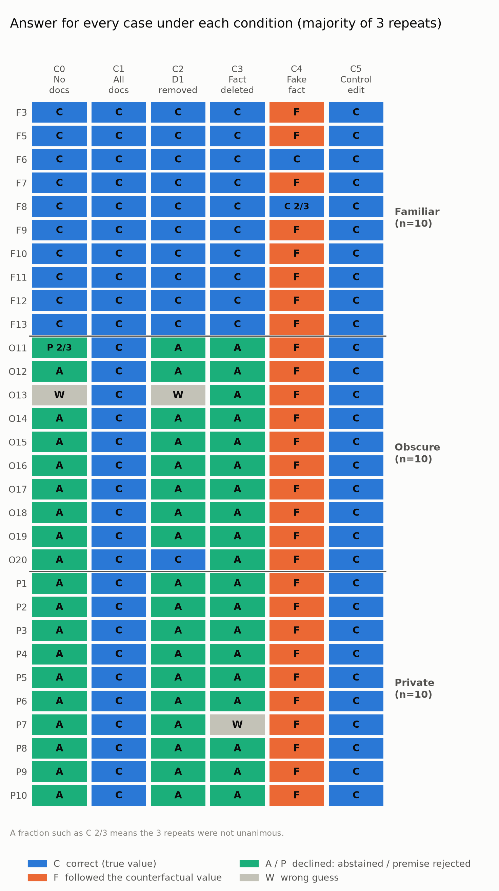
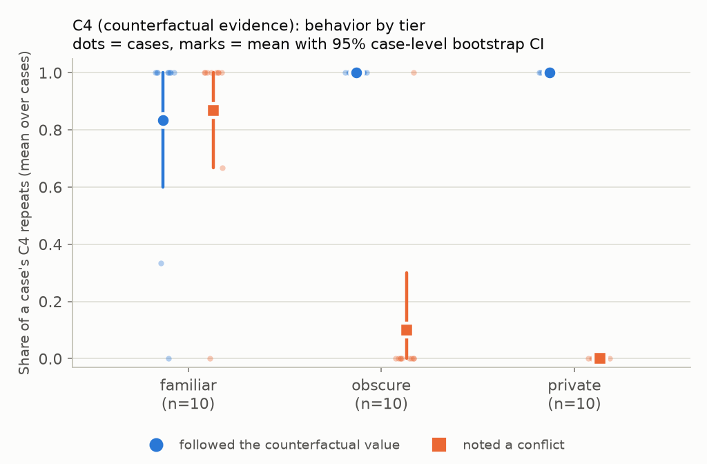

# To What Extent Do LLMs Actually Rely on Retrieved Evidence When Generating Answers?

An Explainable AI (XAI) experiment, not a RAG chatbot. It studies one dimension of that question: **do the documents an LLM cites actually shape its answers?**

A citation can be *correct* (the cited document supports the claim) without being *faithful* (the document influenced the claim). This project edits the evidence a model sees and watches how its answers and citations respond. It uses Claude Sonnet 4.6 on AWS Bedrock and 30 hand-built questions. Everything here is behavioral description of one model, not a claim about its internal mechanisms.

## Key findings

540 model calls: 30 cases × 6 conditions × 3 repeats, all completed with no errors.

> - **Without documents**, the model answered familiar questions correctly in 30/30 calls and never gave the true value for obscure or private ones (0/60).
> - **When D1 contained a fake value** (C4), the answer followed it in 25/30 familiar, 30/30 obscure and 30/30 private calls.
> - **Removing D1 or deleting its key sentence** changed no familiar answers (0/30 in both), but changed nearly all obscure and private ones (27 to 30 of 30).
> - **A control edit** elsewhere in D1 changed no answers (0/90).

**Headline observation.** In the familiar tier, the model said the document conflicted with what it knows in 26 of 30 C4 calls. In 15 of those calls it described the document as false and still gave the answer the document contained. The model sometimes explicitly described retrieved evidence as false while still adopting its counterfactual answer. This is an exploratory, post hoc coding of what the model *said*, not a measurement of its reasoning.



*One cell per case and condition (majority of 3 repeats): C = correct (true value), F = followed the counterfactual value, A/P = declined (abstained / premise rejected), W = wrong guess.*

## Hypotheses

- **H1:** LLMs rely more on pretrained knowledge than on retrieved evidence, and shift toward evidence when their knowledge is insufficient. *Prediction:* familiar cases follow a fake value less often than obscure ones. *Observed:* 0.83 vs 1.00 (difference -0.17, 95% interval [-0.40, 0.00]), in the predicted direction with wide uncertainty. Although familiar cases followed the fake evidence slightly less often, they still adopted it in 83% of calls (25/30), so these results do not support a strong version of the hypothesis that pretrained knowledge dominates retrieved evidence.
- **H2:** when an LLM has relevant knowledge, it answers from it but still cites retrieved sources. *Prediction:* familiar cases keep their answer under C3 and C4 while still citing D1. *Observed:* familiar cases kept the true value in 30/30 C3 calls and cited D1 in 6 of them. An unchanged answer does not by itself show a citation was post hoc.

Further hypotheses (knowledge conflicts, source prioritization, other models) are planned for Project 2. The protocol numbers them across the whole program, so H2 appears there as H6.

## How it works

**Cases.** 30 questions, each with a three-sentence supporting document (D1) and two distractors (D2, D3). Tiers are assigned from what the model answers with *no* documents:

| Tier | Cases | What it is |
|---|---|---|
| Familiar | 10 | Well-known facts |
| Obscure | 10 | 2026 events, after the model's training cutoff |
| Private | 10 | True facts about the researcher, not public |

**Conditions**, run 3 times per case with the same prompt and settings (temperature 0, forced structured output):

| ID | Condition | What changes |
|---|---|---|
| C0 | No documents | Question only |
| C1 | Original | D1 + D2 + D3 |
| C2 | Removal | D1 removed |
| C3 | Masking | D1's key sentence deleted |
| C4 | Replacement | The key value in D1 swapped for a fake one |
| C5 | Negative control | An unrelated sentence in D1 edited |

The primary experiment uses fixed, researcher-controlled evidence sets to isolate the effect of document changes on model responses. A separate TF-IDF retrieval analysis (9 pilot cases, in the [research record](docs/research_record.md)) evaluates whether relevant documents can be retrieved from a larger corpus.

The model returns an answer, the documents it cites, an abstention flag, a conflict flag and a 0 to 100 confidence. D1's position is counterbalanced across cases (seed 590). Intervals are case-level bootstrap (10,000 resamples). The design follows Wallat, Heuss, de Rijke and Anand (2025), [*Correctness is not Faithfulness in RAG Attributions*](https://doi.org/10.1145/3731120.3744592), as a small black-box adaptation, not a reproduction.

## Results by tier

| Tier | C4: followed fake value | C4: noted a conflict | C2: answer changed | C3: answer changed |
|---|---|---|---|---|
| Familiar | 25/30 | 26/30 | 0/30 | 0/30 |
| Obscure | 30/30 | 3/30 | 27/30 | 30/30 |
| Private | 30/30 | 0/30 | 30/30 | 30/30 |



Self-reported confidence was high when the model answered (about 98 for true answers, 93 for fake-value answers) and low when it declined (about 20). Intervals, citation tables, the exploratory composite score and every other breakdown are in the [full analysis](results/full_v1_combined/full_v1_combined_analysis.md).

## Case study: citation vs. explanation

For F12 ("Who wrote *Romeo and Juliet*?"), D1 normally says "It was written by William Shakespeare." In C3 that sentence is deleted. In all three repeats the model still answered William Shakespeare and cited the modified D1, while its own explanation said: *"Doc 2 mentions Romeo and Juliet but does not explicitly name the author. However, it is universally known that William Shakespeare wrote Romeo and Juliet."* The citation field lists a document that the explanation says does not contain the answer. The same disagreement appears in 9 of 9 C3 calls that cited D1 without support (F12, F13, P7). This is an observation about two outputs disagreeing, not a claim about why.

## Secondary analysis: end-to-end RAG

The controlled experiment hands the model a fixed D1 plus two distractors. As a pre-registered secondary analysis, the model instead answers from what a retriever finds. Each question is a TF-IDF query over about 190 documents (D1, D2, D3 of all 30 cases plus the 100 frozen filler documents); the top 3 are shown in a seeded shuffled order. Prompt, output format, model and settings are unchanged. 30 cases × C1–C5 × 1 repeat = 150 calls, about $0.88. C0 is not run (nothing to retrieve).

| | End-to-end RAG | Fixed evidence |
|---|---|---|
| C4: followed the fake value, all cases | 0.93 [0.83, 1.00] | 0.94 [0.86, 1.00] |
| C4: familiar | 0.80 [0.50, 1.00] | 0.83 [0.60, 1.00] |
| C4: obscure / private | 1.00 / 1.00 | 1.00 / 1.00 |
| C4: noted a conflict | 10/30 | 29/90 |
| Control edit (C5) changed the answer | 0/30 | 0/90 |
| Filler documents cited | 0 of 150 calls | not applicable |

- **Retrieval.** D1 was in the top 3 for 30/30 questions in C1, C4 and C5, and for 23/30 in C3 once its key sentence was deleted. Because every modified D1 was retrieved, C4 following is the same whether or not it is conditioned on retrieval.
- **Noted conflicts.** Of the 10 C4 calls that flagged a conflict, 8 still gave the fake value (7 of 9 familiar; fixed evidence: 24 of 29). Of the 6 whose explanation called the document false, 5 still gave the fake value (fixed evidence: 15 of 15). The RAG conflict types are keyword suggestions, not human-confirmed.
- **When D1 was not retrieved** (all 30 C2 calls plus 7 C3 calls): familiar questions were answered from the model's own knowledge (12/12 true), obscure ones mostly declined (9 of 11 declined, 1 true, 1 wrong guess), private ones always declined (14/14). Almost none of these calls cited anything.
- **Observation: cross-case contamination.** The shared corpus lets one case's documents compete with another's. For O17 (who shared the 2026 Chemistry prize with Kagan) the retriever returned O20's distractor, which names the Medicine laureates, and the model used it in all five conditions: it gave those laureates as the answer in C2 and C3 and appended them to the correct name in C1, C4 and C5. Nothing like this can happen with fixed evidence.

**Limitations.** One repeat per cell, so there is no noise floor and no C5 validity gate; the comparison with the three-repeat primary experiment is descriptive and does not show that the two are equal. The 21 new cases have no same-topic hard negatives, so their retrieval is easier than the 9 original cases'; the two groups are reported separately in the [full tables](results/rag_gen_v1/rag_gen_v1_summary.md). The familiar tier has only 10 cases, so its interval is wide. This is a secondary analysis; the fixed-evidence experiment stays primary.

**In one sentence:** the pattern from the controlled experiment reappears under end-to-end retrieval.

## Limitations

- One model, one prompt, 10 cases per tier; intervals are wide and many are zero-width because every case agreed.
- Tiers are confounded with fact type (well known, post-cutoff, personal), and in the obscure and private tiers "keeping the original answer" could not occur because the model never gave the true value without documents.
- Some distractors leak cues: O20's distractor names the other laureates, so the model answered correctly in C2 without D1.
- The conflict-type labels and the citation-versus-explanation check are post hoc and exploratory; labels were suggested by the assistant and approved by the researcher, with no second rater.
- Black-box only: the data cannot say why an answer changed or stayed the same.
- The model under study and the coding assistant are both Anthropic models.

The full list is in the [research record](docs/research_record.md).

## Reproduction

Requires Python 3.12 and AWS Bedrock access to Claude Sonnet 4.6 in `us-east-1`, through a local AWS profile named `xai-bedrock` (keys are never stored in the repo).

```bash
python3 -m venv .venv && source .venv/bin/activate && pip install -r requirements.txt
python scripts/validate_cases.py --cases data/cases_full.json          # no API calls
python src/interventions.py --cases data/cases_full.json --name full   # build C0 to C5 evidence
python src/run_experiment.py --conditions-file data/full_conditions.jsonl --run-name full_v1 --dry-run
python src/run_experiment.py --conditions-file data/full_conditions.jsonl --run-name full_v1 --confirm   # 522 calls, about $3
python src/evaluate.py results/full_v1/full_v1.jsonl --cases data/cases_full.json
python src/analyze.py results/full_v1/full_v1_scored.csv
```

The 30th case (P10) was added after this run and executed separately as `full_v1_addendum` (18 calls, same prompt and settings). The two logs are concatenated into `results/full_v1_combined/` for the 30-case analysis; the exact commands are in the [research record](docs/research_record.md#reproduction). Total spend for the project, including the end-to-end RAG secondary analysis, was about $6.64.

## Where things are

| Path | What it holds |
|---|---|
| [docs/protocol_v1.1.md](docs/protocol_v1.1.md) | Hypotheses, conditions, scoring rules, and the Deviations Log of every change after v1.0 |
| [results/full_v1_combined/full_v1_combined_analysis.md](results/full_v1_combined/full_v1_combined_analysis.md) | Complete tables, intervals and detailed findings |
| [docs/research_record.md](docs/research_record.md) | The long-form write-up: design decisions, all results, limitations, reproduction, costs |
| `data/` | The 30 cases, generated evidence for each condition, frozen filler documents |
| `src/`, `scripts/` | Prompt, interventions, runner, scoring, analysis, validators |
| [src/rag_generation.py](src/rag_generation.py), [src/rag_evaluate.py](src/rag_evaluate.py) | End-to-end RAG secondary analysis: TF-IDF top-3 retrieval and the model call; scoring and the side-by-side comparison with the fixed-evidence run |
| [results/rag_gen_v1/](results/rag_gen_v1/) | End-to-end RAG run (150 calls): raw log, scored calls, review files and [summary](results/rag_gen_v1/rag_gen_v1_summary.md) (the 6-call pilot is in `results/rag_gen_pilot/`) |
| `results/` | Raw per-call logs and scored outputs (never hand-edited) |

## AI assistance

This project was built with substantial help from Claude Code (Anthropic's command-line coding assistant), used interactively. The assistant wrote and revised the code, validators, scoring and analysis scripts, and drafts of the protocol amendments and this README, under the researcher's direction. The researcher defined the research question, hypotheses and design, supplied the private-fact cases, made the protocol decisions, approved every API run, and approved the manual review and conflict-type labels. Case facts and sources are in `data/cases_full.json`
